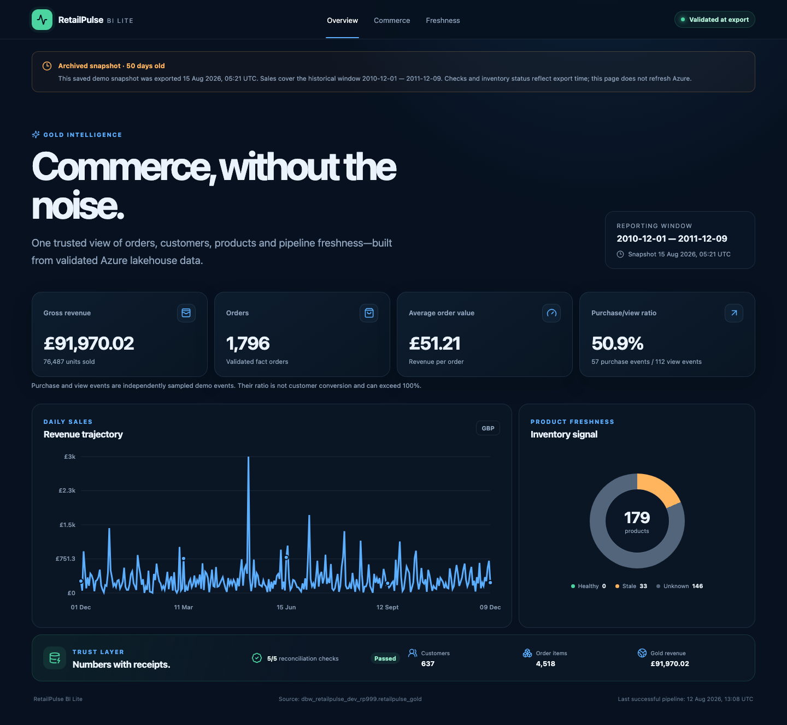
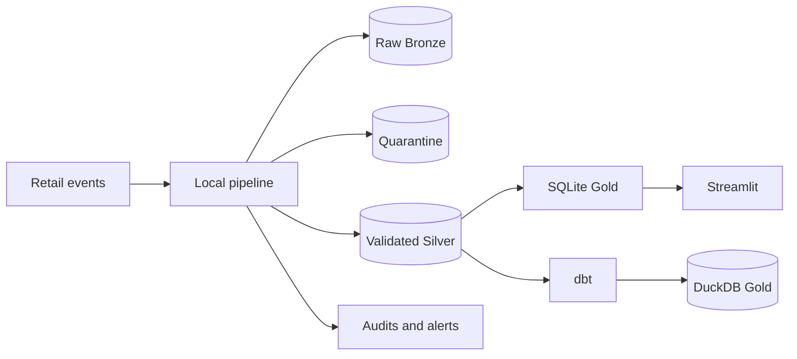

# RetailPulse

[](https://github.com/PK-999/retailpulse/actions/workflows/ci.yml)

A retail data engineering portfolio: generate events, retain raw data, validate and deduplicate
Silver, build tested Gold marts, and explain data-quality incidents.

[Live portfolio dashboard](https://pk-999.github.io/retailpulse/) ·
[5-minute walkthrough](docs/portfolio-walkthrough.md) ·
[Demo guide](docs/demo-guide.md) · [Verification](docs/project-status.md) ·
[Releases](https://github.com/PK-999/retailpulse/releases)



## Ready to run

The complete local demo needs **Python 3.11–3.13** and no Azure credentials, Docker, or hosted
AI service. It includes five traffic scenarios, Bronze/Silver/quarantine processing, SQLite
analytics, three dbt builds in DuckDB, reconciliation, metrics, and an incident report.

The public React dashboard displays a saved Azure Gold export from **15 August 2026**.
Azure integrations have historical evidence; fresh Azure deployment and alert delivery are
outside the current zero-additional-cloud-cost release. [Read the scope](docs/project-status.md).

## Quick start

From a fresh checkout, with Python 3.11 installed (3.12 or 3.13 also works):

```bash
git clone https://github.com/PK-999/retailpulse.git
cd retailpulse
python3.11 -m venv .venv
source .venv/bin/activate
make install
make demo
make dashboard
```

The dashboard opens at `http://localhost:8501`. The demo retains its data and proof under
`data/portfolio-demo/`. Each demo run requires a new directory; repeat with
`make demo DEMO_DIR=data/another-demo`, then use the same `DEMO_DIR` for the dashboard.

Expected results:

| Check | Result |
|---|---|
| Input classification | 295 Bronze = 266 Silver + 19 duplicates + 10 quarantined |
| Commerce | 10 orders, 57 units, £268.55 |
| dbt | 37 nodes pass in each clean, incremental, and full-refresh build |
| Replay | Unchanged ingestion reads zero input; unchanged dbt marts stay unchanged |
| Reconciliation | SQLite totals and dbt Gold agree; incremental results match full refresh |

Run `make help` for commands. See the [demo guide](docs/demo-guide.md) for failure scenarios,
monitoring, the public dashboard, and recording.

## Engineering coverage

| Capability | Where to look |
|---|---|
| Batch ingestion | [CSV normalization](src/retailpulse/batch.py), [ADF assets](azure/adf/), [Databricks batch](databricks/batch_bronze_silver.py) |
| Streaming | [Event generator](src/retailpulse/events.py), [Kafka producer](src/retailpulse/producer.py), [local Spark/Delta](spark/local_stream_bronze_silver.py) |
| Contracts and quality | [Shared v1 contract](src/retailpulse/contracts.py), validation, deduplication, late/malformed quarantine |
| Recovery | [Transactional processing](src/retailpulse/pipeline.py), [storage](src/retailpulse/storage.py), [crash tests](tests/test_recovery.py) |
| Analytics engineering | [dbt project](dbt/): dimensions, facts, incremental marts, relationships, SCD Type 2 history |
| Operations | [Monitoring](monitoring/), run audits, Prometheus/Grafana, [rules and optional Ollama](src/retailpulse/incident.py) |
| Platform | [Terraform](terraform/), managed identities, Docker, [four CI jobs](.github/workflows/ci.yml) |
| Consumption | [Streamlit](dashboard/app.py) for local operations; [React/TypeScript](bi-dashboard/) for the archived public snapshot |

## Local flow



SQLite is the local system of record; JSONL and checkpoint files are repairable exports.
The separate Kafka/Spark path writes Delta tables. The [architecture](docs/architecture.md)
explains these execution paths and the optional Azure deployment.

## Validate

With the Python environment activated:

```bash
make lint
make test
make e2e
```

Frontend checks need Node.js 24 and Playwright Chromium:

```bash
npm --prefix bi-dashboard ci
npm --prefix bi-dashboard exec -- playwright install chromium
make verify
```

CI exercises Python/dbt/SQL, frontend browser tests, actual Spark/Delta recovery, and offline
Terraform validation. [Dated evidence](docs/evidence/README.md) records what was tested.
`make install` includes the Databricks adapter for offline SQL fixture tests; these tests require
no Azure credentials or service access.

## Repository map

| Directory | Responsibility |
|---|---|
| `src/retailpulse/` | Domain contract, generation, ingestion, storage, quality, incidents, CLI |
| `scripts/` | One complete local demo, data preparation, optional Azure operations |
| `dbt/` | Staging, dimensions/facts, marts, snapshot, analytical tests |
| `dashboard/`, `bi-dashboard/` | Local operations and public snapshot applications |
| `spark/`, `databricks/`, `azure/`, `terraform/` | Spark/Delta and optional cloud implementation |
| `monitoring/` | Prometheus rules and provisioned Grafana dashboard |
| `tests/`, `docs/` | Regression checks, architecture, operator guides, verification evidence |

The [documentation index](docs/README.md) links the remaining reference material.
