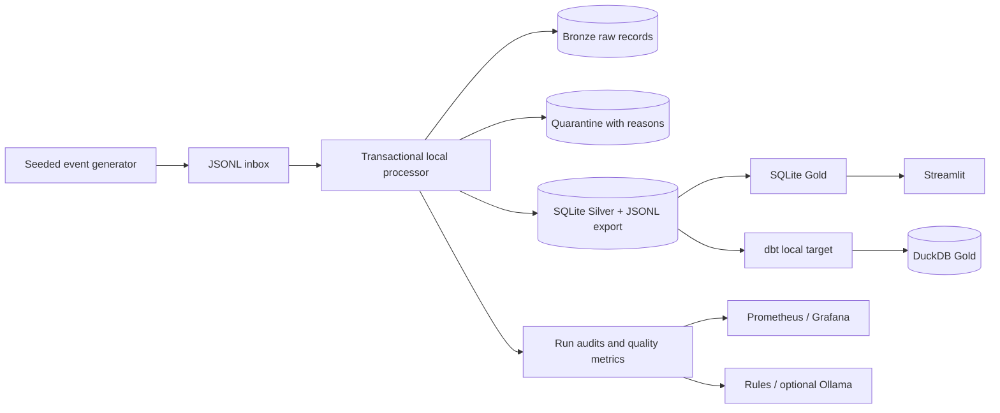
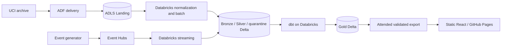
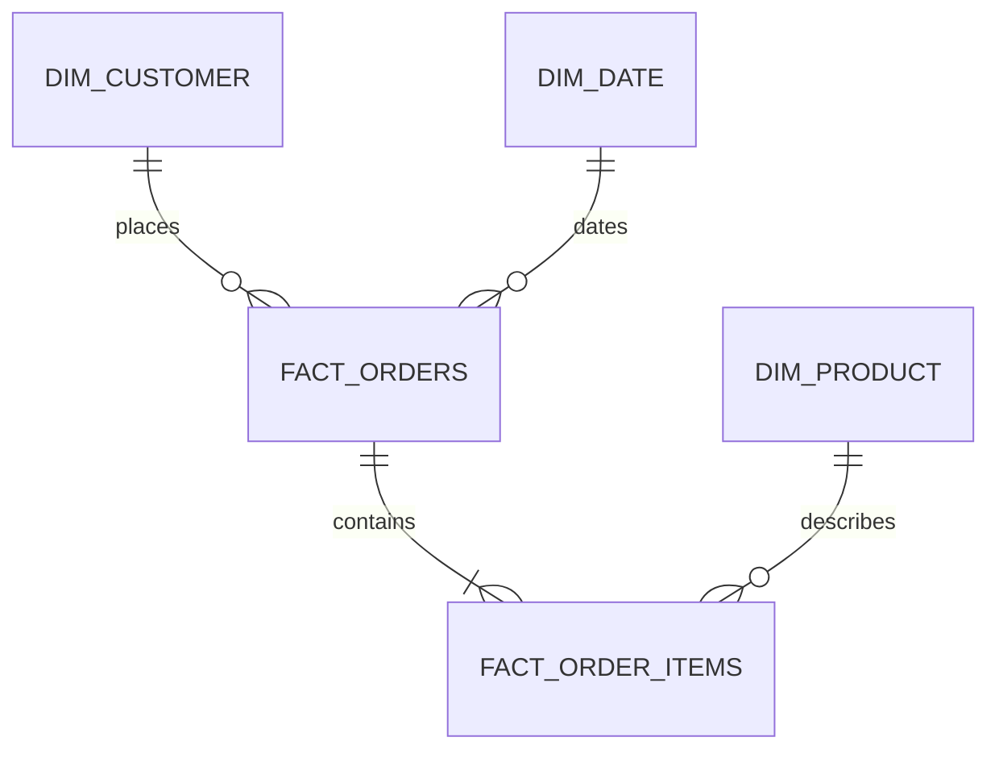

# Architecture

RetailPulse has three execution paths. The default local path is a complete portfolio demo;
the local Spark path proves Kafka/Delta semantics; the Azure path is an optional deployment
with historical August evidence. They share contracts and analytical concepts, not a single
always-running environment.

## Complete local path

The [single demo runner](../scripts/run_local_e2e.py) generates five scenarios and exercises this
path. It forces file transport, uses a new isolated directory, and compares unchanged incremental
marts with a full refresh. Streamlit and dbt have independently reconciled Gold representations.

SQLite commits raw records, classifications, offsets, and audits in one transaction. Silver's
primary key prevents duplicate event IDs. Bronze/Silver/quarantine JSONL, metrics, and checkpoint
files are atomic derived exports, repaired after process loss. Exporting multiple files is not
one distributed transaction.

## Component responsibilities

| Module or directory | Responsibility |
|---|---|
| [`contracts.py`](../src/retailpulse/contracts.py) | Versioned event schema, routing, exact prices, validation context |
| [`events.py`](../src/retailpulse/events.py), [`producer.py`](../src/retailpulse/producer.py) | Seeded retail relationships, scenarios, file/Kafka transport |
| [`pipeline.py`](../src/retailpulse/pipeline.py) | Input consumption, classification, replay handling, local Gold |
| [`storage.py`](../src/retailpulse/storage.py) | Schema/migrations, transactional ledger, atomic exports |
| [`monitoring.py`](../src/retailpulse/monitoring.py), [`incident.py`](../src/retailpulse/incident.py) | Quality rules, metrics, grounded incident analysis |
| [`cli.py`](../src/retailpulse/cli.py) | Operator commands and guarded data reset |
| [`batch.py`](../src/retailpulse/batch.py) | UCI CSV normalization into four historical entity datasets |
| [`spark_contract.py`](../src/retailpulse/spark_contract.py) | Shared Python/Spark validation and standalone notebook bundling |
| [`dbt/`](../dbt/) | Staging, dimensions/facts, incremental marts, SCD2 snapshot, tests |
| [`dashboard/`](../dashboard/), [`bi-dashboard/`](../bi-dashboard/) | Local operational view and public archived snapshot view |

## Kafka and Spark/Delta path

The producer can publish to Redpanda's Kafka endpoint. The
[local Spark job](../spark/local_stream_bronze_silver.py) retains raw Kafka coordinates in Bronze,
validates events with the shared contract, retains rejected/late evidence, and uses Delta MERGE
for Silver. Separate checkpoints support bounded `AvailableNow` runs and recovery tests.

The standalone [Databricks notebook](../databricks/stream_bronze_silver.py) bundles the exact
validator source. [Spark/Kafka evidence](evidence/local-spark-contract.md) covers real workers,
post-MERGE failure, checkpoint replay, and target-side duplicate audit reconciliation. The local
Delta tables are a separate fixture; the quick demo's DuckDB profile reads its JSONL Silver export.

## Optional Azure path

Terraform defines service boundaries, identities, access, and optional monitoring. Azure stage
runners perform attended jobs and cleanup; Stage 7 temporarily enables Event Hubs. These scripts
are optional cloud operations and are excluded from `make demo` and local CI execution.
See the [Azure plan](execution-plan.md) and [cost strategy](cost-strategy.md).

The public browser reads only the checked-in aggregate snapshot. It has no warehouse token or
query capability, and page views start no Azure compute. A separately authorized refresh queries
Azure Gold, reconciles Silver/Gold, atomically replaces the snapshot, and verifies warehouse stop.
The saved export remains dated **15 August 2026**.

## Analytical model

`fact_order_items` has the order-item grain; `fact_orders` aggregates orders. `daily_sales`,
`customer_360`, and `inventory_health` serve consumption. The product snapshot records SCD Type 2
price history. Changed order dates repair both previous and new daily aggregates.

Silver retains exact price text. Gold rounds unit price half up to two decimals before multiplying
quantity, consistently across SQLite and dbt. Purchase/view ratio uses independently sampled
events; it is not customer conversion and can exceed 100%.

## Reliability invariants and tradeoffs

- Raw input is retained even when validation fails; quarantine includes payload and reason.
- Silver contains at most one row per event ID; replay does not create extra accepted records.
- Event times are timezone-aware UTC. Lateness is measured against ingestion time, with rejection
  retained rather than silently evicted by stateful watermark cleanup.
- The local adapter assumes one attended writer and completed, append-only file deliveries.
- Prefix hashing and exports rescan history. The bounded scale observation is not a production SLA.
- Backdated ingestion before an incremental boundary needs explicit replay/full refresh.
- Deletes, enterprise CDC, richer returns/cancellations, and production load certification are
  outside this portfolio release.
- Incident detection is deterministic. Model output is advisory and performs no remediation.

See [the contract](data-contract.md), [requirements](requirements.md), and
[project status](project-status.md) for the exact acceptance and evidence boundaries.
